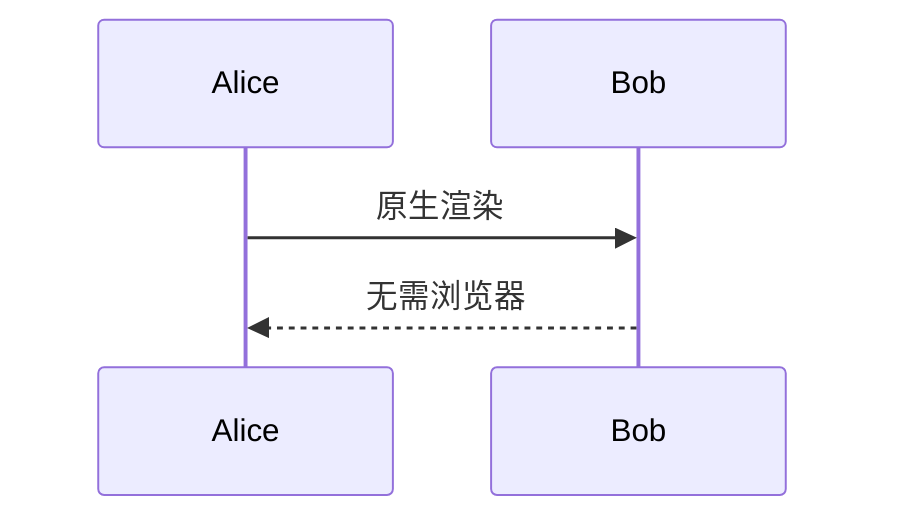
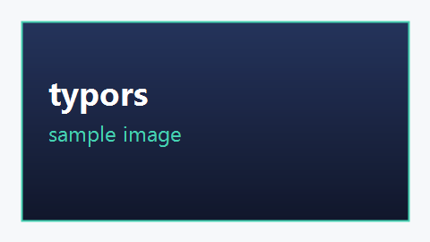

# typors 混合编辑器 spike

这是**粗体**与*斜体*以及`行内代码`混排的一段正文。这一行用来验证 H3 的 span 映射在中文标点、全角字符与行内样式边界上是否保真。

## 二级标题里有 中文 与 emoji 😀

- 无序列表第一项，含 **粗体**
- 无序列表第二项，含 `code()`
- 无序列表第三项

1. 有序列表第一项
2. 有序列表第二项，含 *斜体*

```rust
fn main() {
    // 围栏代码块里的注释
    println!("你好，世界");
}
```

> 引用块里的一段文字，用来确认块级标记也会被当作零宽遮罩。

嵌套强调：外层**粗体里嵌 *斜体中文* 与外层 emoji 😀 的粗体**结尾。

删除线：~~已废弃~~；行内 HTML：<b>粗体</b>、<i>斜体</i> 与 <code>代码</code>。<br>HTML 换行之后。

富内容：图片、公式、表格、行内 HTML 与原生 mermaid。

```chart
pie

a: 10%
b: 30%
c: 50%

a.color: #FF0000
a.label: Test
```

```chart
line

a: [1, 2, 3, 4, 5]
b: [1, 2, 3, 4, 5]

a.color: #FF0000
a.label: Test
a.marker: *
```




| 列一 | 列二 |
|---|---|
| 1 | 2 |

行内公式 $E = mc^2$，块级公式：

$$
\frac{a}{b} = \sqrt{x}
$$




